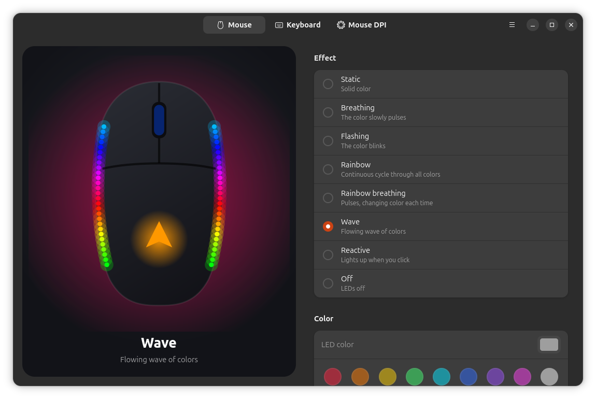
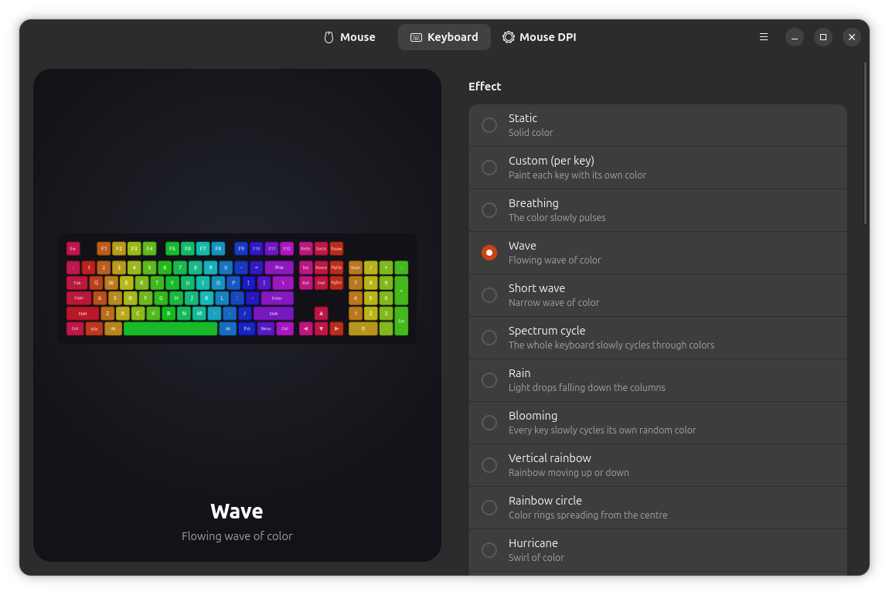

# Redragon RGB

Configure the RGB lighting of the **Redragon M711 Cobra** mouse and the **Redragon K556**
keyboard on Linux — a native GTK4 / libadwaita app for GNOME plus a CLI for scripting.
No vendor software, no Windows, no pip dependencies.





| Device | USB ID | Status |
|---|---|---|
| M711 Cobra | `04d9:fc30` | tested |
| M711-FPS-1 Cobra FPS | `04d9:fc62` | untested |
| K556 (EVision controller) | `320f:5000` | tested |
| K556 (SONiX controller) | `0c45:5004` | untested |

## Features

- One tab per device (Mouse / Keyboard) with an animated preview of the effect
- **Mouse:** static, breathing, flashing, rainbow, rainbow breathing, wave, reactive, off
- **Keyboard:** static, breathing, wave, short wave, spectrum cycle, rain, blooming, reactive, vertical rainbow, rainbow circle, hurricane, accumulate,
  starlight (fast/slow), visor, ripple, reactive line, off — single color or multicolor, with direction
- **Mouse DPI and profiles:** switch the active profile, set the five DPI levels the DPI button
  cycles through (and which of them are enabled) and the report rate; values are read back from
  the mouse after every write
- **Keyboard per-key colors:** click or drag on the keys in the preview to paint them
- Color picker with quick presets, speed and brightness sliders; colors are gamma-corrected so
  the LEDs match what you see on screen
- **White balance** per device: lower the red, green or blue gain if white looks tinted
- Optional live apply; at startup the mouse page shows what is actually stored in the mouse
  (the keyboard page shows the last settings applied by the app)
- Settings are stored in the devices' own memory (all 5 mouse profiles), so they persist across
  reboots and on other computers

## Installation

### Debian / Ubuntu package (recommended)

Requires Ubuntu 25.04+ / Debian 13+ or any release with libadwaita ≥ 1.6.
Download the `.deb` from the [latest release](https://github.com/codingkoala/redragon-rgb/releases/latest), then:

```sh
sudo apt install ./redragon-rgb_*_all.deb
```

`apt` pulls in the dependencies and the package installs the udev rule. Unplug and replug the
devices once, then start **Redragon RGB** from the application menu (or run `redragon-rgb`).

### From source

```sh
sudo apt install python3-gi python3-gi-cairo gir1.2-adw-1 libusb-1.0-0
git clone https://github.com/codingkoala/redragon-rgb.git
cd redragon-rgb
sudo ./install-udev.sh   # once: USB/hidraw access for the desktop user
./install.sh             # launcher in ~/.local/bin + application menu entry
```

Unplug and replug the devices after installing the udev rule. To try it without installing:
`python3 -m redragon_rgb`. To build the `.deb` yourself: `packaging/build-deb.sh`.

## CLI

```sh
redragon-rgb-cli list
redragon-rgb-cli mouse static -c "#00e5ff" -b 3
redragon-rgb-cli mouse breathing -c ff1e3c -s 5
redragon-rgb-cli keyboard wave -m -s 4 -d right
redragon-rgb-cli keyboard static -c 2f6bff -b 4
redragon-rgb-cli keyboard off
redragon-rgb-cli keyboard custom --fill 2f6bff --key w=ff1e3c --key a=ff1e3c --key s=ff1e3c --key d=ff1e3c
redragon-rgb-cli list-keys      # key names for --key
redragon-rgb-cli white-balance keyboard 92 100 85   # red/green/blue gains in percent
redragon-rgb-cli status         # lighting and DPI currently stored in the mouse
redragon-rgb-cli mouse-dpi      # show DPI levels and report rate of every profile
redragon-rgb-cli mouse-dpi --profile 1 --levels 400,800,1600,3200,6400 --enabled 1,1,1,1,0 --poll 1000
redragon-rgb-cli mouse-profile 2
redragon-rgb-cli restore        # re-apply the last saved settings to every device
```

## How it works

### M711 mouse

The mouse is driven with USB control transfers (HID `SET_REPORT`, report `0x02`) on vendor
interface 2, through libusb loaded with `ctypes`. hidraw cannot be used because the mouse's report
descriptor declares no feature reports.

| Frame | Meaning |
|---|---|
| `02 F5 00` | unlock (starts every sequence) |
| `02 F3 <addr> <len> 00 00 00 <data>` | write |
| `02 F1 02 04` | apply |
| `02 F5 01` | lock (ends every sequence — mandatory) |

Reading: a seek frame `<id> F2 <addr> <count>` followed by `GET_REPORT`, which returns an
8-byte header plus the data. DPI of profile *n* is read as 32 bytes (report 3) at
`0x0042 / 0x0102 / 0x01B2 / 0x0262 / 0x0312` and written as 4 bytes per level
(`enabled, code, high, code`) at those addresses + 2 + 6 × level, then applied with `F1 02 02`;
DPI = code × 10000/225 × 2^high, and only the X value is used by the firmware. Report rate:
`0x0032` / `0x0038`; active profile: `0x002C`.

LED of profile *n* (0–4): `0x0449 + 8n` → `R, G, B, mode1, speed, mode2`; brightness:
`0x044F + 8n`. Color and mode are always written together: writing only the color while a
color-less effect is active freezes the LED animation.

Protocol knowledge comes from [dokutan/mouse_m908](https://github.com/dokutan/mouse_m908),
[OpenRGB](https://gitlab.com/CalcProgrammer1/OpenRGB) and
[SK2674/m711-port](https://github.com/SK2674/m711-port), which measured the transport and the
firmware pitfalls on real hardware.

### K556 keyboard

64-byte HID output reports (report `0x04`) on the vendor interface (usage page `0xFF1C`) via
hidraw, with a checksum of bytes 3–63; the keyboard acknowledges every packet. Each command is
wrapped in `begin` (`0x01`) / `end` (`0x02`); parameter 0 sets mode, brightness (0–4),
speed (5 slow → 0 fast), direction, multicolor flag and RGB.

Mode codes differ between firmware revisions. The ones used here were verified on a K556 with
the EVision controller and match OpenRGB's EVision table; the SONiX revision maps several codes
differently (see [syndicalt/openrgb-reddragonk556-controller](https://github.com/syndicalt/openrgb-reddragonk556-controller)).
To check what a code does on your keyboard: `redragon-rgb-cli probe-keyboard 0x04`
(add `--dir 0` or `--dir 1` to test the direction byte).

## Roadmap

- [x] K556 keyboard (effects)
- [x] K556 per-key colors
- [x] Read the current mouse lighting and DPI back at startup
- [x] Mouse DPI levels, report rate and active profile
- [x] White balance per device

## License

GPL-3.0-or-later
